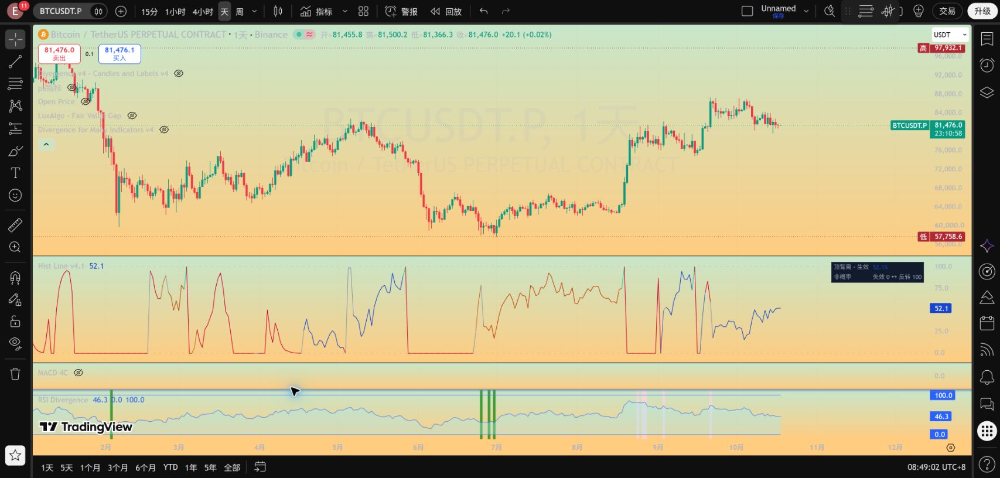
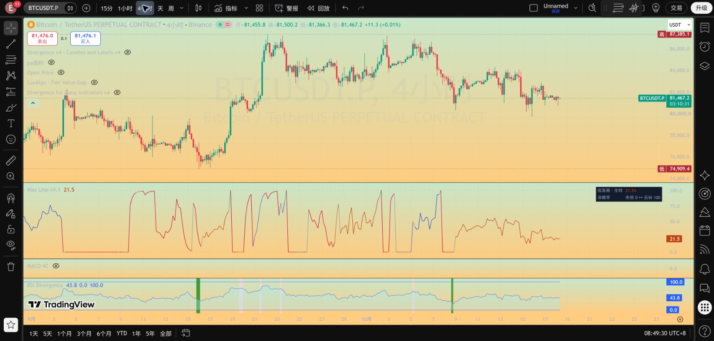

# MACD Histogram 背离连续进度线：完整使用手册

适用版本：**Hist Line v4.1**。文档更新：2026-10-18。

[指标源码](../pine/Hist_Divergence_Line_v4_1.pine) · [v4.1 显示变更](HIST_LINE_V4_1_GUIDE.md) · [原始进度公式说明](HIST_PROGRESS_V4_GUIDE.md) · [验证记录](../results/hist_line_v4_1/checks.json)

## 1. 这个指标回答什么问题

它用一条副图折线表达两个不同阶段：

1. **正式背离前**：相对于一个已确认的历史价格枢轴，当前价格与 MACD Histogram 是否逐渐接近底背离或顶背离关系。
2. **正式背离后**：价格处于生效时冻结的失效价和反转确认价之间的什么位置。

它不是原始 Hist 数值折线，也不是 RSI、超买超卖评分或成功概率。形成 80% 不代表有 80% 的概率成功；结构 80% 表示当前价格位于失效边界到确认边界之间的 80% 位置。

当前研究背景是 **BINANCE:BTCUSDT.P 的 4H 和日线**。两个周期各自独立计算；脚本没有把日线信号自动合并到 4H，也没有多周期共振评分。其他品种可运行，但不能直接沿用本项目历史研究结论。

## 2. 安装与日常查看

1. 打开上方源码链接，使用 GitHub 的 Raw 或下载功能取得完整 `.pine` 文本。
2. 在 TradingView 打开 `BINANCE:BTCUSDT.P`，选择 4 小时或日线。
3. 打开 Pine 编辑器，用完整源码替换旧版，保存后更新到图表。
4. 确认副图左上角显示 **Hist Line v4.1**。若同时加载了旧版本，隐藏或移除旧版，避免误把多条指标叠加成一张图。
5. 默认使用细线、两行小面板、关闭详细标签。历史复盘时把光标移到目标 K 线，并查看 TradingView 数据窗口中的审计字段。

当前两行面板只说明**最新一根**的状态；移动十字光标不会把该面板变成历史状态表。历史状态以数据窗口对应 K 线的字段为准。

更新源码不会自动改写已经创建的 TradingView 警报实例。需要让既有警报使用新脚本或新参数时，应重新创建相应警报；本次代码上传不会代用户创建警报。参见 [TradingView 官方警报说明](https://www.tradingview.com/pine-script-docs/concepts/alerts/)。

## 3. 如何看颜色、阶段和数值

| 显示 | 含义 | 应怎样理解 |
|---|---|---|
| 较淡橙线 | 正在显示潜在底背离形成过程 | 原始形成程度最高 99，尚未正式生效 |
| 较淡蓝线 | 正在显示潜在顶背离形成过程 | 同上，方向相反 |
| 实色橙线 / 蓝线 | 底 / 顶背离已正式生效，进入结构阶段 | 数值改为冻结结构中的实际价格位置 |
| 红线 | 当前形成关系撤销、连线受阻，或正式结构触及失效位 / 已收盘失效 | 红色本身不能区分预警与正式失败，要结合面板或数据窗口 |
| 绿色结果段 | 收盘已经严格越过反转确认价 | 记录本事件反转确认，不保证之后持续上涨或下跌 |
| 灰色连接段 | 更换参照、方向或计算阶段，或者暂时没有候选 | 不应把灰线当成同一背离的进度继续发展 |

颜色有优先级：风险红色优先于灰色切换提示；旧事件成功且没有同根启动的新事件时，结果显示绿色。日线和 4H 使用同一套颜色。

正式启动根本身也是一次阶段切换，因此在没有红色优先警告时，该连接段会呈灰色，随后才显示方向实色。不要仅凭这一根的颜色判断是否生效，应查看面板或 `Audit Start`。

为满足连续折线要求，v4.1 不再画三角、圆点、叉号或参照菱形。正式触发根也**不再强行把主线拉到 100**：当根直接采用新结构的真实位置。原始形成全部通过的 100 保留在数据窗口“正式形成确认 100”，同时可由“Audit Start”、面板和正式生效警报识别。

因此，主线达到 100 不等于刚刚发生背离；结构阶段达到 100 也可能只是盘中触到确认边界。**正式反转确认还需要收盘严格越界。**

### 实图

日线：



4H：



截图为当时行情快照，数值不代表当前实时读数。其他副图是截图所在布局的原有指标，不属于本指标输出。

## 4. 形成进度的比较基准

### 4.1 历史枢轴与 Hist 必须来自同一根 K 线

当前实现仅处理**常规背离、Close 价格源**，没有加入隐藏背离。

- 价格枢轴使用 Close 的 `ta.pivothigh/ta.pivotlow`，默认左右各 5 根。
- 只有右侧确认根收盘后，枢轴才进入可用数组，历史曲线不会回填到枢轴发生的那一根。
- 每个方向从原算法最近 10 个枢轴池中，选择跨度 **大于 5 且不超过 100 根**的最近可用枢轴作为形成参照。
- 比较价格是该枢轴 K 线的 Close，比较 Hist 是**同一根 K 线**的 MACD Histogram。
- Hist 计算为 MACD 线减信号线，默认参数为 12、26、9。

形成显示跟踪的是“最近合格候选”。正式算法则在原枢轴池中寻找“最近一个通过全部检查的枢轴”，两者可能不同。显示候选不能限制正式算法选择，也不能把当前候选的进度声称为未来正式事件必然采用的进度。

### 4.2 两项条件分别评分

令当前价格为 `P`、当前 Hist 为 `H`，参照枢轴 Close 为 `P0`、同根 Hist 为 `H0`。

新参照建立时冻结两个尺度：

- `A`：前一根已收盘的 ATR(14)。
- `S`：前 20 根已收盘 Hist 的总体标准差。

两个分母至少取一个最小报价单位，避免零波动除零。它们在同一个候选参照内保持不变，换参照时才重新冻结。

| 有利距离 | 底背离 | 顶背离 |
|---|---|---|
| 价格距离 `dp` | `(P0-P)/A` | `(P-P0)/A` |
| Hist 距离 `dh` | `(H-H0)/S` | `(H0-H)/S` |

令价格接近范围为 `Bp`，Hist 接近范围为 `Bh`，默认均为 1：

```text
价格得分 = clamp(100 × (1 + dp/Bp), 0, 100)
Hist得分 = clamp(100 × (1 + dh/Bh), 0, 100)
原始形成进度 = min(99, 价格得分, Hist得分)
```

`clamp` 表示把结果限制在给定区间内。例如价格得分 100、Hist 得分 20，综合只有 20，不会因为一项条件满足就接近完成。

底背离示例：参照 Close=100，当前 Close=100.2，冻结 ATR=1，则价格得分为 80。若参照 Hist=-2、当前 Hist=-2.3、冻结标准差=1，则 Hist 得分为 70，原始形成进度为 70。之后价格降到 99.8、Hist 升到 -1.8，两项均为 100，但原始形成进度仍为 99，不能绕过正式检查。

等于参照值时分项可以达到 100；正式算法要求的价格和 Hist 关系使用严格不等式，因此“接近程度满分”与“正式条件通过”不是同一件事。

### 4.3 为什么主线有时与原始进度不同

v4.1 为减少多线交叉，在形成阶段只展示一个主要方向：

1. 初始选择有候选且综合分数较高的一侧；相等时选择底侧。
2. 保持这个方向，直到它失去可用候选，或其分数低于 50 且另一侧高出超过 25 分。
3. 正式事件生效后，主线直接跟随正式事件方向。

两侧原始候选始终独立计算，另一侧分数仍可在数据窗口查看。主要方向选择只是显示规则，不能阻止另一方向正式触发。

形成主线默认做 3 根递推平滑：`显示值 = 0.5×当前原始值 + 0.5×上一显示值`。一般参数 `n` 的系数为 `2/(n+1)`；设置为 1 就是原始值。换方向、枢轴或阶段时重新开始，不将不同参照的分数混入同一平滑序列。

**平滑显示有滞后，可能暂时高于或低于当前原始形成值；是否满足两项条件必须看原始分项。** 红色条件破坏提示不平滑，正式背离也不读取这个平滑值。

没有可用候选时，用灰线保持上一显示数值以维持连接，面板显示“暂无候选”。该段没有有效进度含义；最早没有任何候选时的 50 只是中性连接起点。

## 5. 什么时候正式背离生效

原始正式搜索、事件生命周期与警报代码保留。主要条件为：

1. 底背离：正式比较端点的 Close 低于历史枢轴 Close，同时 Hist 高于对应历史 Hist；顶背离相反。
2. 正式比较端点是**前一根 K 线**（`start=1`）；形成显示使用当前根（`start=0`），两者不是同一个端点。
3. 检查两端之间的每一根价格和 Hist，原虚拟连线不能被中间值穿破。
4. 当前根满足原来的拐头条件：底侧为 Hist 上升**或** Close 上升，顶侧为 Hist 下降**或** Close 下降。
5. 等当前根收盘，且满足跟踪起始时间和 ATR 条件。

同一根同时出现相反正式原始信号时，不开启新的冲突事件。已有事件存续时，后续信号不会重置冻结边界；先结束旧事件，再允许同一收盘开启一个新事件。

形成红线表示当前端点的连线受阻，或该参照下此前已收盘满足过的价格 / Hist 严格关系现在被撤销。红色可以恢复，并不永久宣判该参照失败。两项端点分数即使接近 99，连线检查仍可能不通过。

## 6. 正式生效后的结构进度

在正式生效收盘时，取正式参照枢轴至生效当前根的完整区间，冻结区间最高价、最低价和 ATR(14)：

| 项目 | 底背离 | 顶背离 |
|---|---|---|
| 反转确认价 `C` | 冻结区间最高价 | 冻结区间最低价 |
| 失效价 `I` | 区间最低价 − 0.5×ATR | 区间最高价 + 0.5×ATR |
| 反转正式确认 | 收盘 `> C` | 收盘 `< C` |
| 正式结构失效 | 收盘 `< I` | 收盘 `> I` |
| 盘中触线预警 | 当前 low `<= I` | 当前 high `>= I` |

```text
结构进度 = clamp(100 × (当前价格-I)/(C-I), 0, 100)
```

顶背离中分母是负数，同一公式依然保证失效=0、确认=100。例如顶背离 `I=110、C=90`，当前价格为 100，结构位置就是 50。

结构阶段不平滑。价格越过边界时显示值截在 0 或 100，实际边界价格及结果另存审计字段。等于确认价 / 失效价不算收盘正式越界。

盘中触及失效位立即红色预警，即使本根价格收回，high/low 仍会保留触线事实，本根可以继续显示红色。是否正式失效仍由收盘判断。生效根上已经发生的早先影线不用于给这个新事件预警；从后续根开始跟踪。

没有固定等待期限，横盘等待不会因为根数达到上限而自动失败。`最大背离跨度`限制的是寻找背离参照的跨度，不是正式事件等待反转的期限。

## 7. 参数说明

以下是源码默认值，也是本版显示验证采用的设置；它们不是本次重新寻优得到的“最优参数”。

| 设置 | 默认值 | 作用及改变后的影响 |
|---|---|---|
| 枢轴确认根数 | 5 | 左右确认各 5 根；会影响正式枢轴与信号 |
| 检查最近枢轴数 | 10 | 原算法搜索范围；会影响正式信号 |
| 最大背离跨度 | 100 | 原参照最大跨度；不是事件有效期限 |
| MACD 快线 / 慢线 / 信号线 | 12 / 26 / 9 | 改变 Hist 和背离条件 |
| 结构失效缓冲 / ATR(14) | 0.5 | 改变失效边界及事件结果，不能继续照搬原结果 |
| 跟踪起始时间 | 2021-01-01 00:00 UTC | 决定正式事件从何时开始；更早图表数据仍用于预热 |
| Hist 波动窗口 | 20 | 仅形成显示的标准化尺度 |
| 价格接近范围 / ATR | 1 | 更大范围让距离参照较远时仍有一定接近分数；不改变正式信号 |
| Hist 接近范围 / 标准差 | 1 | 同上，作用于 Hist 接近分数 |
| 形成曲线平滑根数 | 3 | 仅显示平滑，1=不平滑；更大会增加显示滞后 |
| 折线粗细 | 1 | 纯显示设置 |
| 显示详细标签 | 关闭 | 开启会增加生效 / 结果文字标签，不影响信号 |
| 显示进度面板 | 开启 | 最新状态两行面板 |
| 面板位置 / 字号 | 右上 / 小 | 纯显示设置 |
| 底 / 顶背离颜色 | 深橙 / 深蓝 | 方向颜色，可自行修改 |

参数变更会让 TradingView 重新计算历史。不要把参数重算后的历史图误当成当时实时看见的原始记录。

## 8. 数据窗口与警报

复盘可以按下面顺序检查目标 K 线：

| 字段 | 用途 |
|---|---|
| 主线阶段 | 0=无候选连接，1=形成，2=结构，3=结果 |
| 主线方向 | 1=底，-1=顶，0=尚未选择 |
| 主线参照或阶段切换 | 1 表示该根发生了显示口径切换 |
| 底 / 顶形成原值 0–99 | 未平滑的两方向综合值 |
| 底 / 顶价格接近程度、Hist接近程度 | 检查是不是两项同时接近满足 |
| 底 / 顶参照时间、Close、Hist | 定位历史参照及同根数值 |
| 冻结归一化 ATR、Hist 标准差 | 复算该候选的分数 |
| 当前连线通过、条件破坏 | 解释高分为何仍没有正式触发 |
| 正式形成确认 100、Audit Start | 正式事件启动；Start 为底1顶-1 |
| 正式事件原始参照时间 / Close / Hist | 原算法实际选中的参照，可能不同于显示候选 |
| Audit Active Direction | 当前事件方向，无事件为0 |
| Audit Confirmation / Invalidation | 当前事件冻结的确认价 / 失效价 |
| 结构价格位置 | 未平滑的真实结构进度 |
| Audit Success / Failure | 当根收盘完成的旧事件方向；随后可同根启动新事件 |
| 结构触线预警 | 1 表示此前已生效事件在本根触及失效位，包含收回情况 |

部分“正式事件原始参照”字段在事件结束后仍保留上一次记录；须结合当前阶段、Active Direction 和 Start 字段，不能仅因字段非空就认为仍有事件。

现有四类警报条件为：**底背离正式生效、顶背离正式生效、结构反转确认、背离结构失效**。均基于原有收盘事件脉冲。潜在形成和盘中触失效位只做曲线 / 面板提示，本版没有新增对应的盘中推送条件。

## 9. 历史复盘、实时变化与验证范围

正式枢轴只在当时已知时加入，没有负偏移回填，也没有跨周期前视。形成曲线可以上升、下降、撤销，已经结束事件的结果不会被后来的价格改写。

但仍需区分三类记录：

- **历史收盘形成值**：由当时可用的历史数据计算，可以逐根复算。
- **结构影线触线**：可由历史 high/low 验证是否发生，但同一根内高低价先后顺序未知。
- **盘中出现又消失的潜在变化**：普通历史 OHLC 无法完整重建，重载图表也不会保留所有实时 tick 的路径。本版不使用无法历史复现的锁存方式伪装这些路径。

连续灰色连接只是一种显示约定，不代表参照相同，也不是用未来点插补历史计算。图表加载起点、参数、交易所行情修订不同，重新计算的输出可能不同。

| 已完成验证 | 范围 |
|---|---|
| v4 新增测试与生命周期测试 | 14 项形成 / 结构测试、8 项生命周期测试通过 |
| v4 离线历史回归 | 2,114 根日线、12,684 根 4H；正式事件分别 39、202，与保存的旧版规则和事件记录一致 |
| v4.1 源码回归 | 正式与候选核心、警报文本和条件与 v4 一致 |
| v4.1 显示检查 | 单条可见曲线、零 plotshape；14,798 根离线显示值有限且在 0–100，结构值未平滑，前缀重算一致 |
| TradingView | 日线和 4H 编译 / 实图检查通过，编辑器源码与本地文件核对一致 |
| 尚未完成 | 完整历史 TradingView 导出对账、对形成进度本身的预测效果验证、未来实时记录验证 |

离线验证是 Python 规格回放，不是 Pine 解释器。这里的事件数量是回归覆盖信息，不是这次新增的胜率统计。旧研究的准确率不能套到每个形成进度百分比上。

## 10. 文件与复现入口

| 内容 | 文件 |
|---|---|
| 当前指标 | [Hist_Divergence_Line_v4_1.pine](../pine/Hist_Divergence_Line_v4_1.pine) |
| v4.1 显示变更 | [HIST_LINE_V4_1_GUIDE.md](HIST_LINE_V4_1_GUIDE.md) |
| 底层形成 / 结构公式 | [HIST_PROGRESS_V4_GUIDE.md](HIST_PROGRESS_V4_GUIDE.md) |
| 最新显示检查 | [checks.json](../results/hist_line_v4_1/checks.json) |
| TradingView 检查 | [tradingview_checks.json](../results/hist_line_v4_1/tradingview_checks.json) |
| 底层历史逐根回放 | [results/hist_progress_v4](../results/hist_progress_v4) |
| 原研究数据 | [data](../data) |
| 历史回测及报告 | [results](../results) / [reports](../reports) |
| 文件完整性清单 | [manifest.sha256.json](../manifest.sha256.json) |

在项目根目录执行：

```text
python src/verify_hist_line_v41.py
python run_hist_progress_v4.py
python src/check_manifest.py
```

第一条验证当前单线显示及源码回归；第二条重新生成 v4 形成 / 生命周期回归；第三条核对归档完整性。重跑会改写相关结果文件，若要制作新的分发包，应运行 `python src/package_release.py` 重新生成清单与 ZIP。已有 GitHub Release 保留历史快照，下载时请核对版本。

本次文档补全没有修改指标逻辑、参数默认值或已保存的回测数据。源码的 MPL-2.0 许可及原始算法作者署名保留在文件头和项目许可文件中。
