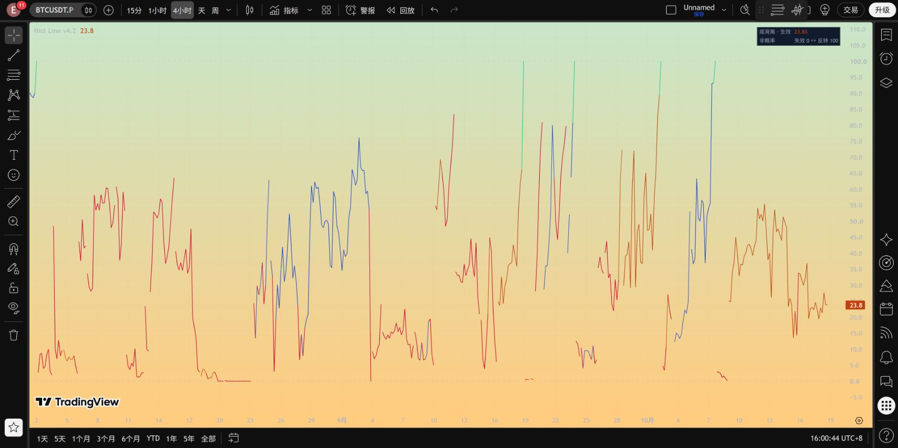
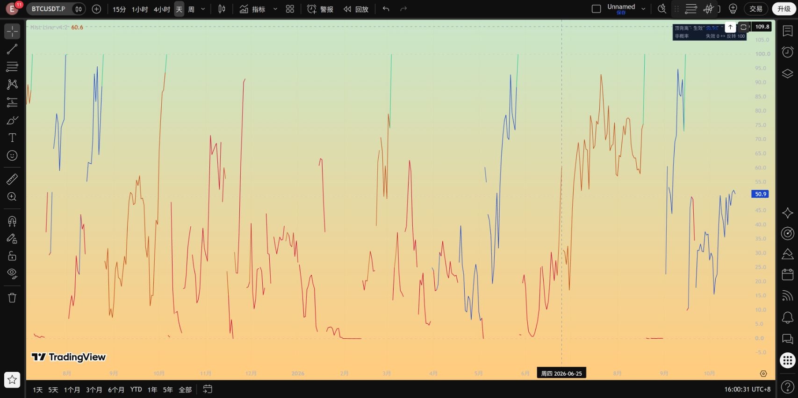

# Hist Line v4.2：枢轴动态进度与 v4.1 对比

日期：2026-10-18。[新版源码](../pine/Hist_Divergence_Line_v4_2.pine) · [保留的 v4.1](../pine/Hist_Divergence_Line_v4_1.pine) · [检查结果](../results/hist_line_v4_2/checks.json)。

本版改变**展示用评分、展示候选的选择和连线方式**。MACD、正式枢轴数组、正式 `f_find` 搜索、拐头条件、收盘触发、结构价位冻结、确认/失效、同根重启规则及四类警报均与 v4.1 一致。测试逐字比对该核心区块，不通过重写正式算法来改善曲线。

## 1. v4.1 为什么尖峰多

1. 原评分为 `clamp(100*(1+标准化有利距离),0,100)`。距离为 0 时已经满分，从 -1 个波动单位到 0 就走完 0–100；阈值附近斜率为每单位 100 分。刚好达到参照值，综合便可能被截到 99。
2. 形成分母只用一个较短波动窗口，并在候选建立时冻结。若当时 Hist 很平静，较小的后续变化就会放大成很大的得分变动。
3. 原显示候选始终选最新枢轴。新的已确认枢轴出现，参照价格、Hist、分母一起更换，曲线却被直接连接。
4. 方向选择较快切换，且每次切换都会重置显示 EMA。平滑无法消除重新初始化造成的跳变。
5. 形成程度、结构位置、最终结果是不同含义。把形成 90 与新结构 10 连成一条陡线，并不代表原背离突然衰退 80 分。

因此本版没有继续加长移动平均或限制每根涨跌幅，而是修改形成分数的映射与参照管理，并停止连接不能直接比较的点。结构位置中的真实价格跳动不隐藏。

## 2. 新形成评分：参照关系临界点为 50

仍取原算法已确认的历史 **Close 枢轴 `P0`** 和该根 **Hist `H0`**。当前价格为 `P`，当前 Hist 为 `H`。

新候选建立时，使用上一根已经收盘的数据冻结尺度：

```text
A = max(ATR14[1], 0.5*ATR100[1], 最小报价单位)
S = max(Hist标准差20[1], 0.5*Hist标准差100[1], 最小报价单位)
```

短 Hist 窗口仍可由“Hist 波动窗口”修改；长窗口固定 100，保护系数固定 0.5。长尺度下限用于避免短期安静区间产生极小分母，不是用历史极值替代背离参照。尺度在同一候选内保持冻结，不能随着每根波动变化凭空推高分数。早期长尺度尚未就绪时回退到已有短尺度与报价单位下限。

| 标准化有利距离 | 底侧 | 顶侧 |
|---|---|---|
| `zp` | `(P0-P)/A` | `(P-P0)/A` |
| `zh` | `(H-H0)/S` | `(H0-H)/S` |

```text
单项分数(z) = 100 / (1 + exp(-z))
价格分数 = 单项分数(zp / 价格评分尺度)
Hist分数 = 单项分数(zh / Hist评分尺度)
综合形成值 = min(99, 价格分数, Hist分数)
```

两个评分尺度参数默认均为 1；指数输入截在 ±20 仅为数值稳定。两项取较小值，不能用一项优势掩盖另一项不足。

| 有利距离（单位：冻结尺度） | -2 | -1 | 0 | +1 | +2 | +3 |
|---|---:|---:|---:|---:|---:|---:|
| 新单项分数 | 11.9 | 26.9 | 50.0 | 73.1 | 88.1 | 95.3 |

价格/Hist 刚到原参照附近时，得分在 50 附近自然通过，不再直接饱和。两项严格有利时综合通常大于 50；但正式背离还需要原连线、拐头和收盘检查。

**50 是端点关系的临界位置，100 不是形成阶段必须爬到的目标。** 正式信号可能在形成值 51、60 或其他数值时通过，且原正式算法可能采用另一个历史枢轴。不能拿显示分数作新的触发阈值。全部正式条件通过的 100 仍保留在数据窗口“正式形成确认 100”。

没有使用时间 EMA、逐根限速或事后插值。新曲线的自然变化来自评分函数的连续性和更稳定的参照；在临界点的灵敏度约为原来四分之一。这个分数表示归一化端点关系，不是成功概率，也不包含连线检查通过的概率。

## 3. 展示候选更稳定，但不约束正式算法

每个方向仍只使用原搜索池中最近 `maxPivots` 个已确认枢轴，要求跨度大于 5 且不超过 `maxBars`，默认 10 与 100。

- 没有可用参照时，选择最近的合格枢轴。
- 当前参照仍在原可用池内时，优先保持，不因一个新枢轴出现就立即换基准。
- 若当前候选连续 **3 个已收盘**状态都被破坏，且存在更新的合格枢轴，下一次计算可以换到新参照。
- 超出原搜索范围或不再属于原池时更换；换参照重新冻结尺度和条件记忆。
- 红色破坏提示从第一次检测到破坏便出现，**不会等满 3 根**。3 根只用于决定展示参照是否让位。

主线只展示一个方向。另一侧比当前侧高出超过 15 分且持续 3 个收盘，才切换主方向；当前侧没有候选时可立即选择可用侧。正式事件生效则立即服从原事件方向，不等待这个显示防抖条件。

这些常数是明确的显示设计规则，没有按历史收益、胜率或某段截图寻优。固定候选与方向防抖会使主线对新候选出现有所迟缓；两方向原值和参照仍保留在数据窗口。正式算法独立搜索原池，不被显示候选锁定，也不受 3 根 / 15 分规则限制。

## 4. 连续的边界：同一基准内连线，换基准不硬连

只有同方向、同参照、同阶段的相邻点才有直接可比性。新版保留一条主要折线，在更换枢轴、方向、进入结构阶段、事件结束后开始新候选时，**不绘制跨口径的连接段**。不是把原始跳变用慢动画或移动平均拖到下一段。

实现上保留真实数值，仅将跨口径线段设为不可见；无候选时值为 `na` 且不跨空白连线。数据窗口仍可读取切换根的当前分数与切换标记。使用方式参考 [TradingView 官方绘图说明](https://www.tradingview.com/pine-script-docs/visuals/plots/)。

所以它是一条**按有效参照分段连续**的曲线，并非跨越所有不同口径也绝不断开的曲线。两种目标无法同时严格满足：强行连续会让不同参照的数值变化看起来像同一背离增强或减弱。本版优先可解释性，不制造这种连续。

默认无历史三角、叉号和密集风险圆点。只有最新根恰好在切换并出现风险时，显示一个小红点，确保连接段隐藏时仍有即时预警；该特殊小点不是历史信号标记。历史切换根的风险记录完整保存在数据窗口和逐根文件中。其余时候风险由红色主线表达。

## 5. 生效后仍是原始结构位置

结构阶段不平滑、不限速，仍为：

```text
结构位置 = clamp(100*(当前价格-冻结失效价)/(冻结确认价-冻结失效价), 0, 100)
```

底背离：确认价为原区间高点，失效价为原区间低点减生效 ATR×0.5；顶背离相反。冻结区间及生效 ATR 的代码未改。正式触发根立即读取实际结构位置，不人为绘制形成 100 尖峰。

- 盘中 low/high 触及已生效事件的失效价：立刻红色预警，当前根即便收回仍保留触线事实。
- 收盘严格越过原失效价：正式失效。
- 收盘严格越过原确认价：正式反转确认。
- 原事件结果根仍属于原结构，正常绘制到 0 或 100，不把真实结果当作需要隐藏的口径切换。
- 旧事件结束并同根启动新事件时，按新事件结构显示；旧事件结果与触线仍记录在审计字段，跨事件不硬连。

颜色维持橙色底背、蓝色顶背、红色条件破坏/结构风险、绿色收盘反转确认。面板为两行，显示最新阶段与数值；历史以数据窗口为准。潜在红色和结构红色都直接由当前条件决定，不经过分数平滑。原四个收盘警报不变，未新增盘中推送。

## 6. 对比检查：变化来自哪里

采用同一套保存的 BINANCE BTCUSDT 永续历史：4H 12,684 根、日线 2,114 根。定义“大跳”为相邻数值差至少 **30 个百分点**。以下既统计原始数值，也单列基准变化，避免把隐藏跨口径连接当作全部算法改善。

| 周期 / 项目 | v4.1 | v4.2 |
|---|---:|---:|
| 4H 所有原始数值大跳 | 915 | 527 |
| 4H 其中跨参照/阶段大跳 | 621 | 344 |
| 4H 同一形成基准内大跳 | 201 | 53 |
| 4H 同一结构内部大跳 | 93 | 93 |
| 4H 形成阶段贴近两端（<1 或 >98）根数 | 2,744 / 6,542 | 489 / 6,542 |
| 日线所有原始数值大跳 | 214 | 131 |
| 日线其中跨参照/阶段大跳 | 131 | 88 |
| 日线同一形成基准内大跳 | 62 | 16 |
| 日线同一结构内部大跳 | 21 | 21 |
| 日线形成阶段贴近两端根数 | 563 / 1,379 | 138 / 1,379 |

同一形成基准内相邻变化的 95 分位数：4H 从 26.65 降至 18.39 个百分点，日线从 30.28 降至 19.26。基准和方向选择也发生了变化，因此两版“同一形成基准内”样本集合并非严格相同，以上是各自实际显示的诊断统计，不是固定候选上的单因素实验。

v4.2 仍有真实大跳，尤其行情剧烈波动或正式事件走到边界时。结构内部大跳数量完全一致，说明没有用视觉平滑掩盖实际结构风险。完整原始变化、口径切换、数据空缺及绘制统计见 [checks.json](../results/hist_line_v4_2/checks.json)。评分语义变了，不能把“极端值减少”直接解释成预测准确性提高。

## 7. 验证与局限

- 正式核心和四类警报与 v4.1 逐字相同；v4.1 源码保留，不覆盖。
- 新增 13 项测试：连续临界、双条件约束、多空镜像、单位变换、尺度下限、方向防抖、即时红色、参照保持/更换、实时回滚、事件重启、无候选不伪造数值等。
- 逐根规格检查保存 14,798 根；结构位置保持原值，全部历史结构触线当根有风险状态。
- 截断输入后重新计算与完整输入的前缀一致；没有用未来数据改变早期输出。
- 离线正式事件覆盖日线 39、4H 202。此次正式记录直接沿用已验证基线，并以 Pine 核心逐字一致保护规则；**不是重新独立回测这些事件的胜率**。
- TradingView 编译与实图结果单独保存在本目录的 `tradingview_checks.json`；离线 Python 规格不是 Pine 解释器，完整历史 Pine 导出对账仍未完成。
- 普通历史 OHLC 不能还原每个盘中 tick 中出现后消失的形成关系。实时条件可以撤销，历史是收盘快照；影线触线可由 high/low 复盘，但无法还原本根高低点的先后顺序。
- 进度是条件接近程度或结构价格位置，始终不是成功概率。新版没有新增交易规则或宣称收益改善。

## 8. 安装、复现与文件

在 TradingView 新建或复制一份指标，粘贴 [v4.2 完整代码](../pine/Hist_Divergence_Line_v4_2.pine)，保存并添加到图表。旧 v4.1 可以留作对照；日常使用时隐藏旧版，避免误以为新版输出两条曲线。

信号默认参数维持：枢轴 5、最近枢轴 10、跨度 100、MACD 12/26/9、失效缓冲 0.5 ATR、跟踪起点 2021-01-01 UTC。旧“形成曲线平滑根数”已取消；新增算法不依赖时间平滑。价格和 Hist 的评分尺度默认 1，只影响展示。长周期保护及候选保持规则写明在本说明中。

```text
python run_hist_line_v42.py
```

运行入口保存测试与诊断日志。源码在 `pine/`，规格代码在 `src/hist_line_v42.py`，测试在 `tests/test_hist_line_v42.py`，逐根数据与检查在 `results/hist_line_v4_2/`，TradingView 实图在 `reports/`。旧版、旧回测和历史发布全部保留。

## 9. TradingView 实际运行

2026-10-18，独立保存新版脚本，保留旧 v4.1。在 BINANCE:BTCUSDT.P 的 4H、1D 图表成功编译并运行。编辑器源码回读与本地源码一致。日线新旧正式结构位置同时为 50.9；4H 首次比较同时为 24.6（实时行情会变化）。这是运行与显示检查，不是全历史 Pine 数据导出对账。

[实测记录](../results/hist_line_v4_2/tradingview_checks.json) · [4H 新旧同图](../reports/hist_line_v4_2_vs_v4_1_4h.png) · [日线新旧同图](../reports/hist_line_v4_2_vs_v4_1_1d.png)




