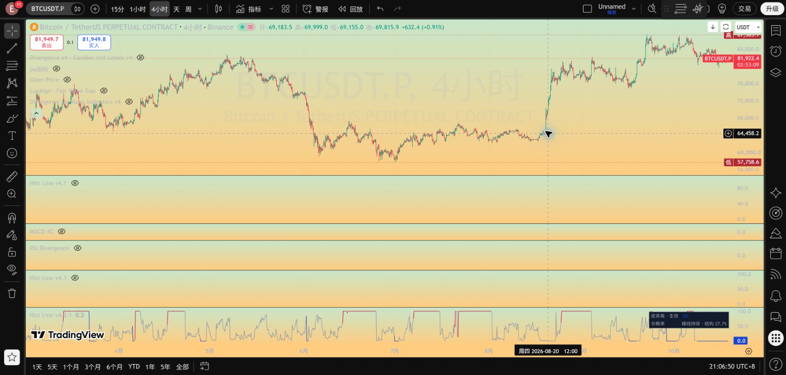
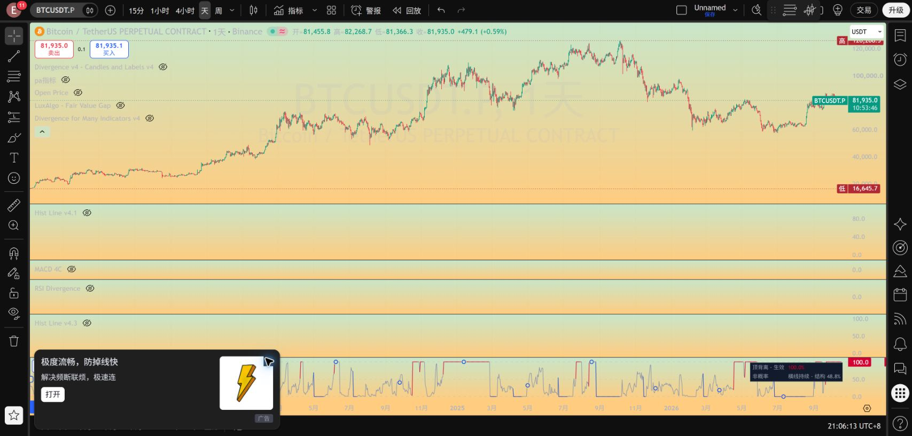

# Hist Line v4.3.1：顶红、底蓝、其余灰

本版仅修改名称、默认配色及主折线颜色选择，共 4 行。主线数值、形成评分、持续横线、正式触发、确认、失效和警报逻辑均与 v4.3 相同。v4.3 源码继续保留。

| 当前状态 | 折线 |
|---|---|
| 正式顶背离生效、尚未结束 | 红色 `#D50032`，保持 100 |
| 正式底背离生效、尚未结束 | 蓝色 `#1744D1`，保持 0 |
| 潜在形成、无候选、反转确认结束根、收盘失效结束根 | 灰色 `#9099AB` |

若旧事件结束的同一收盘启动新事件，按新事件方向着色。触及失效边界但尚未收盘结束时，主线仍保留当前背离方向色；风险文字继续在面板标红，相关数据窗口字段和原警报保留。主折线不再用红色表示潜在破坏，也不再用绿色表示反转确认。

颜色按当前采样点决定，触发或结束处的连接段可能随该点一起变色。历史记录不回改，线条保持连接。默认关闭的详细事件标签沿用原版；本次要求针对主折线。

[完整源码](../pine/Hist_Divergence_Line_v4_3_1.pine) · [差异检查](../results/hist_line_v4_3_1/checks.json) · [横线逻辑说明](HIST_LINE_V4_3_GUIDE.md)

TradingView 独立保存新版，源码回读一致；1D 当前顶背离红色 100，4H 当前底背离蓝色 0，历史非生效曲线灰色。此次为显示运行检查，不重跑胜率。

