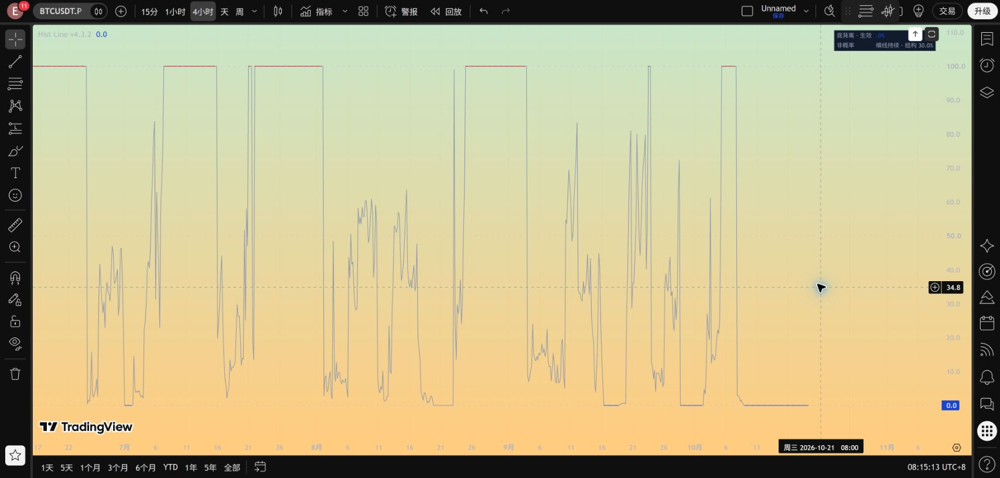
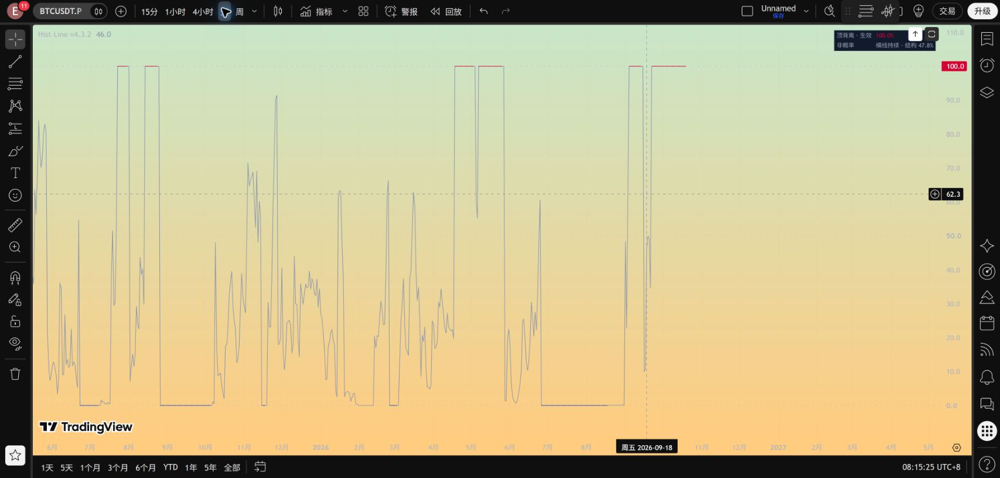

# Hist Line v4.3.2：只给生效横线着色

修复 v4.3.1 在尚未到达 0/100 的连接斜线上提前出现红蓝色的问题。

根因：单条 `plot` 的当前颜色会作用于通往当前点的整个连接段。旧版只根据当前点是否生效选色，因此从形成评分走向生效横线的斜线也被着色。

新版按整段判断。只有以下条件全部成立，该段才着色：

- 当前与上一根都属于正式生效状态；
- 两根属于同一个正式事件，方向相同；
- 两端数值完全相等，且为底背离 0 或顶背离 100。

因此：进入横线的斜线灰色，底背离水平段蓝色，顶背离水平段红色，退出横线或其他阶段灰色。各段连续连接，无空值断口。新事件的第一根已经正式触发，但此时只有一个水平端点；到下一个仍生效的采样点才有可着色的水平段。面板在触发当根就显示方向色，信号和警报没有延迟。

跨事件或顶底切换的连接保持灰色，即使两个不同事件恰好处在同一高度也不混作一次背离。只有一个采样点的事件不会产生彩色水平段，可由数据窗口和原警报复盘。本次没有新增圆点、标签或竖线。

仅修改版本名称和绘图段颜色，所有正式判断、形成评分、横线数值、结构边界及警报与 v4.3.1 相同。旧版保留。

复现：`python src/verify_hist_line_v432.py`。在原来保存的 14,798 根显示记录上检查所有触发进入段为灰色、全部彩色段水平，另覆盖同向重新触发、顶底切换及结束根。该验证是显示规格回归，不是新胜率回测。

[源码](../pine/Hist_Divergence_Line_v4_3_2.pine) · [检查结果](../results/hist_line_v4_3_2/checks.json)

TradingView 独立保存 v4.3.2，源码回读一致，4H、1D 编译运行；实图检查进入 100/0 的斜段为灰色，顶部红色、底部蓝色只沿横线出现。短期实图检查不等同完整历史 Pine 导出对账。

