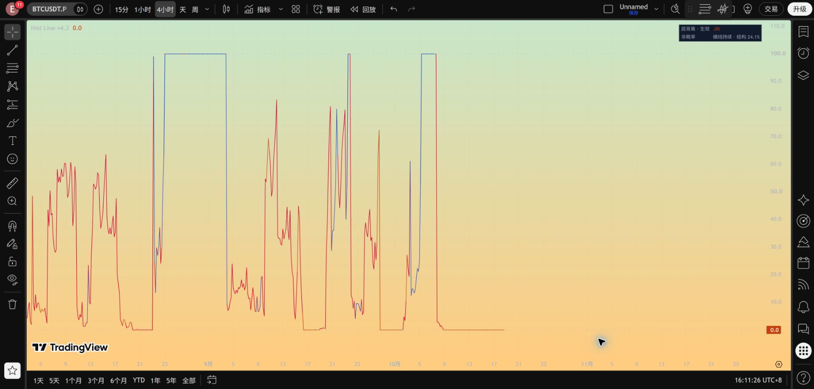
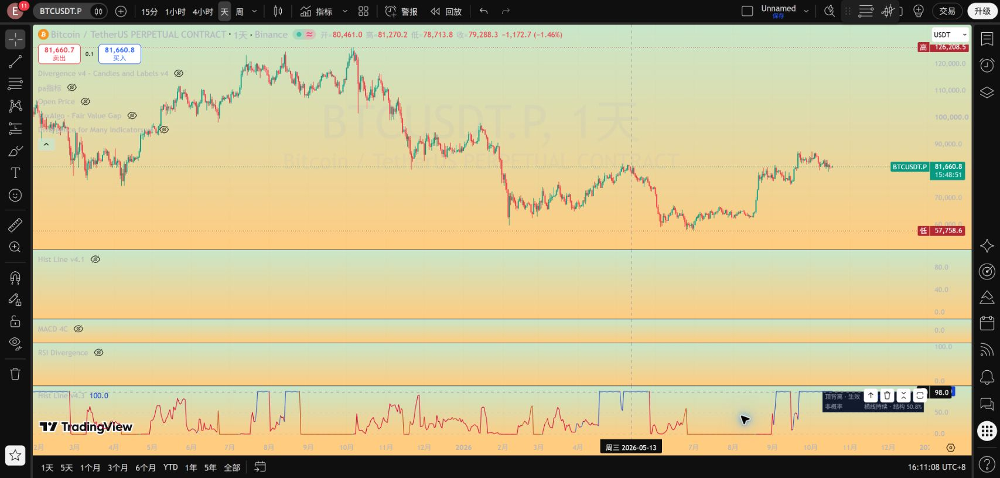

# Hist Line v4.3：生效期间保持横线

2026-10-18。[完整代码](../pine/Hist_Divergence_Line_v4_3.pine) · [显示检查](../results/hist_line_v4_3/checks.json)。v4.2 和全部旧研究保留。

本版按最新需求修改显示，正式触发、收盘确认、收盘失效及四个警报与 v4.2 完全相同；潜在形成评分和候选选择也不变。

| 阶段 | 主线显示 |
|---|---|
| 潜在形成 | 沿用 v4.2 的枢轴比较评分，动态变化 |
| 底背离已生效、尚未结束 | 固定在 0，橙色横线 |
| 顶背离已生效、尚未结束 | 固定在 100，蓝色横线 |
| 盘中触及冻结失效边界 | 横线保持，立即红色预警；正式失效仍等收盘 |
| 收盘反转确认 | 结束根仍在原横线高度，绿色；若同根触失效边界则风险红色优先 |
| 收盘失效 | 结束根仍在原横线高度，红色 |
| 下一根重新形成 | 接回形成评分，连续连接 |
| 无可用候选 | 灰色 50 中性占位，表示暂无候选，不是形成了一半 |

原研究允许旧事件结束后同一收盘启动新事件：这种情况下主线立即显示新事件所在高度，旧事件结果和风险保留在数据窗口，风险红色优先。同方向重新启动可能看起来仍是同一横线，可用事件字段区分。

**主线取消所有断口，不再使用透明连接或切换圆点。** 换参照、换方向、阶段切换时直接连接，可能出现陡斜线；该连接仅保证视觉连续，不代表同一背离的进度突变。切换字段保留在数据窗口，面板在形成参照切换时也有提示。不使用未来数据或人为插值改造历史。

**0/100 在生效阶段是方向状态，不再是当前结构价格位置，也不是成功概率。** 真实结构位置仍实时计算，显示在面板提示及数据窗口“结构价格位置（非胜率）”；正式确认价与失效价继续冻结。结束根颜色只表示该根结果，下一根按新状态着色，不回改整段历史。

检查命令：`python src/verify_hist_line_v43.py`。逐字比较正式核心、形成算法及警报；对保存的 14,798 根记录验证横线、结果根、同根重启、风险优先及无缺值。该检查重用原事件记录，不是新的胜率回测，也不是完整历史 Pine 导出对账。

安装时新建脚本粘贴 v4.3，再隐藏旧版显示即可。默认细线 1，无额外标签；全部旧文件保留。

TradingView 实测状态：独立脚本“Hist 背离持续横线 v4.3”已保存，编辑器回读与本地文件一致。切换到用户已隐藏旧指标的图表后，新版成功编译运行。日线顶背离保持 100，4H 底背离保持 0；面板仍实时显示结构位置。完整历史 Pine 导出对账尚未完成。

[实测记录](../results/hist_line_v4_3/tradingview_checks.json)

