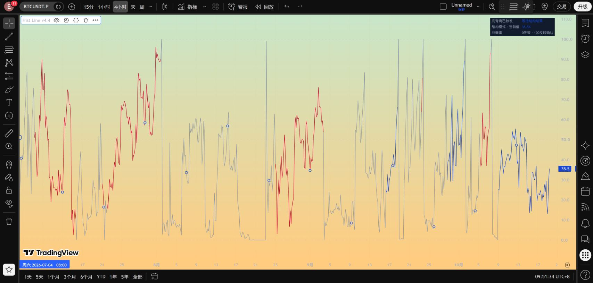
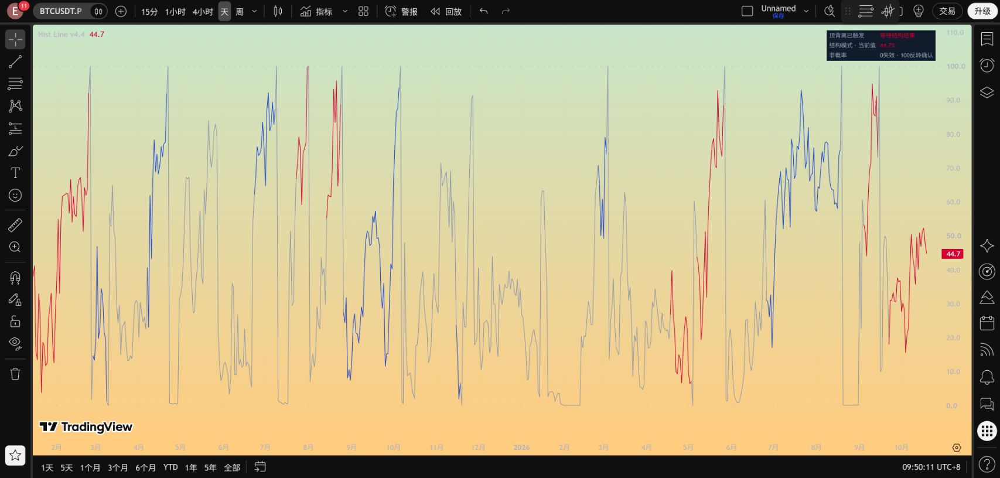
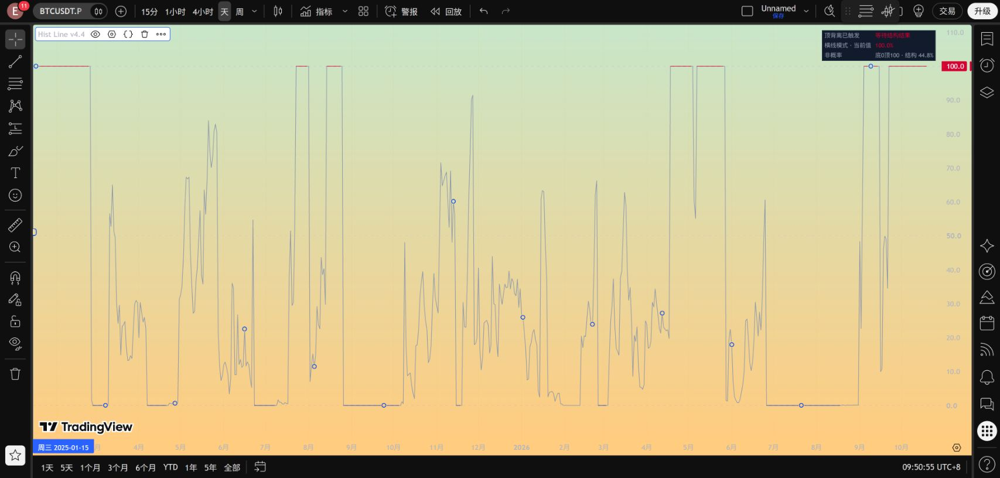

# Hist Line v4.4：结构位置与持续横线双模式

本次只改副图显示。正式背离搜索、历史枢轴、形成评分、事件启动、结构边界、收盘确认/失效、忽略新提示的规则及警报，与 v4.3.2 保持一致。没有增加超时或反向信号替换规则。

修改前的 v4.3.2 及完整回测已经归档并校验：[旧源码发布](https://github.com/Lammmmm/btc-divergence-research/releases/tag/hist-line-v4-3-2) · [旧版本完整回测归档](https://github.com/Lammmmm/btc-divergence-research/releases/tag/hist-v432-backtest-2026-10-19)。旧文件保留。

## 默认：结构位置

设置 → 输入 → 显示 → **主线显示模式：结构位置**。

正式背离触发后，曲线按当前收盘/实时最新价在冻结结构中的位置移动：

`位置 = clamp(100 × (当前价格 − 冻结失效价) / (冻结确认价 − 冻结失效价), 0, 100)`

| 值或颜色 | 触发后的含义 |
|---|---|
| 0 | 到达或越过冻结失效边界 |
| 100 | 到达或越过冻结反转确认边界 |
| 50 | 两个边界的价格中点，不是成功概率 |
| 蓝色 | 底背离事件仍在等待结构结果 |
| 红色 | 顶背离事件仍在等待结构结果 |
| 灰色 | 未正式触发、事件结束，或不同阶段/事件之间的连接段 |

顶背离的确认价低于失效价，公式分母为负，因此价格下跌接近确认位时曲线同样上升。**曲线向上表示接近结构确认，不能直接解释为价格上涨。** 顶/底方向由红/蓝区分。

0、100是价格位置，不直接改变事件状态。价格恰好等于边界时，原规则的严格收盘突破尚未成立；盘中越界也需要等收盘判定。曲线到达端点不等于反转保证成功。盘中影线触及失效价时，面板第三行立即红字预警；即使价格随后回到结构内，当根K线的影线仍会保留这个触及信息。主线方向颜色不被预警覆盖。

正式确认后，该结果K线显示100；正式失效后显示0，连接为灰色。下一根按原有候选形成评分继续绘制。如果同一收盘结束旧事件并启动新事件，新事件的位置优先显示，不把旧事件终点错误接到新事件上。

## 可切回：持续横线

设置中的 **主线显示模式：持续横线** 保留 v4.3.2 的绘制规则：底背离固定0、顶背离固定100，事件结束前持续；只有同一次生效事件内的横线着色，其余连接灰色。

这是两种坐标含义：横线模式的0/100表示方向状态；结构模式的0/100表示失效/确认边界。切换显示模式会重绘历史显示，但不会生成另一套信号或改变事件结果。

## 三行简洁面板

1. “底/顶背离已触发” + **“等待结构结果”**；尚未触发、反转确认、收盘失效分别显示。
2. 当前显示模式和主线数值。
3. 非概率说明、结构边界含义或实时风险提示。

正式触发前仍使用原来的历史价格枢轴及同根Hist条件评分，范围0–99、50为条件临界。此时不是结构价格位置。候选阶段与正式事件阶段的比较基准不同，所以切换连接保持灰色并连续；灰色桥接段不是某一次事件的连续进度。未加移动平均、限速或事后回填，真实价格波动仍可能陡峭。

## 保留的事件规则

- 正式信号等待收盘，默认Hist(12,26,9)、Close、Regular、Pivot5、最近10枢轴、最多100根。
- 冻结背离枢轴到确认当根的高低结构区间；失效边界使用当时ATR(14)×0.5缓冲。
- 顶底共用一个活跃事件，旧事件未结束时不新开事件。没有时间上限。
- 底背离后收盘严格高于确认价才成功，严格低于失效价才失败；顶背离相反。
- 本轮未修改警报代码。新版另存为独立脚本，已有绑定旧脚本的警报不会自动切换。

## 检查与结果解释

[显示回归检查](../results/hist_line_v4_4/checks.json)：4H 12,684根、日线2,114根，共14,798根。持续横线模式每根数值及线段颜色与v4.3.2一致；结构模式的位置逐根与冻结价重算值一致。正式及形成算法代码、审计输出和警报均逐字一致。

4H同一活跃事件内5,740个相邻线段中5,738个位置发生变化；日线658个中658个发生变化。平线问题因此得到显示层面的解决，这不代表提高了预测准确率。触及边界后的截断仍可能产生短暂平线。

复现：`python src/verify_hist_line_v44.py`。这是保存记录上的显示逻辑检查，不是Python直接运行Pine。TradingView实测记录另存；完整历史导出逐根对账仍未完成。[现有回测](../reports/HIST_V432_BACKTEST.md)的事件及交易结果适用于相同信号参数，本次显示修改不产生新的收益提升。

## TradingView 实际运行

2026-10-19，BINANCE:BTCUSDT.P：另存独立v4.4脚本，编辑器回读与本地源码一致；4H、1D均成功编译运行。日线实测切换“结构位置／持续横线”并恢复结构模式。最终图表留在4H结构模式，旧v4.3.2仅隐藏。

[实测记录及限制](../results/hist_line_v4_4/tradingview_checks.json)。这次没有制造或观察实时失效触线，不把界面冒烟检查当成全历史逐根对账。以下为当时截图，最新数值会盘中变化。

### 4H：结构位置

### 1D：结构位置

### 1D：切回持续横线

