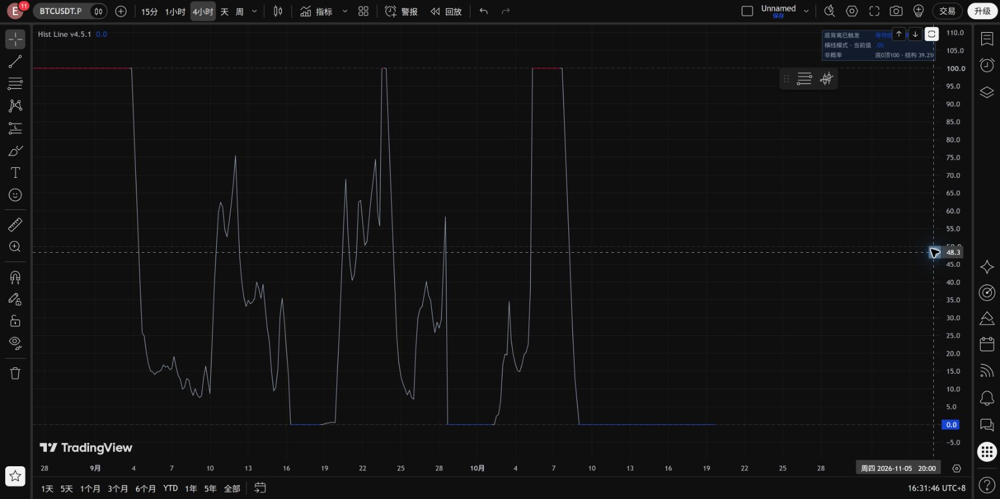
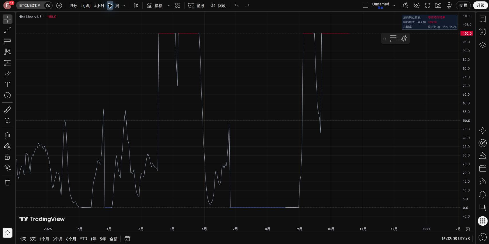

# Hist Line v4.5.1：只在顶部和底部横线着色

修正v4.5把中间结构曲线也染红/蓝的问题。默认显示改回“持续横线”。

- 顶背离正式触发后固定100；只有100处的水平线段为红色。
- 底背离正式触发后固定0；只有0处的水平线段为蓝色。
- 所有中间折线、进入/离开端点的斜线、不同事件之间的连接段均为灰色。
- 同一次事件未结束，端点横线持续；正式反转确认或失效后结束着色。
- 形成阶段保留v4.5平滑，默认周期3、单根变化上限15点；正式事件直接到端点，不让平滑延迟横线生效。进入端点可能陡跳，但这段始终灰色。
- 事件结束当根保留端点结果值并变灰，后续灰线平滑衔接候选阶段。曲线不断开。

MACD、枢轴、背离触发、确认、失效、事件期限和警报均未修改。不存在为了缩短横线而提前取消背离的改动。横线0/100表示底/顶方向状态，不是成功概率；真实结构位置继续显示在面板和数据窗口。

可选“结构位置”模式保留，但同样严格禁止给中间折线着色。想要顶100红横线、底0蓝横线，请使用本版默认的“持续横线”模式。

## 检查

`python src/verify_hist_line_v451.py` 对4H 12,684根和1D 2,114根分别核对两种显示模式：所有彩色斜线、彩色中间线段、事件外着色均为0。默认模式内4H有5,740条、日线658条彩色端点水平线段。两种模式复用相同历史，不是29,596个独立样本。

确认正式核心、原有审计输出和警报与v4.5逐字一致。旧版本完整保留。[检查记录](../results/hist_line_v4_5_1/checks.json)。这属于显示修正，不是新收益回测。

## TradingView 实图

2026-10-19，另存v4.5.1，源码回读一致，4H/1D编译运行通过。默认持续横线模式：只在100/0水平段着色，其余灰色。未做全历史导出对账。

网页核验发现该副图曾启用对数坐标，已切换为“常规”线性坐标。0–100进度应使用线性坐标；对数显示会夸大接近0的变化。此设置属于图表显示设置，不改变脚本计算。编辑器另提示脚本接近Basic计划20秒运行时限；本次两个周期均成功显示，但本版未改动原始搜索循环进行性能优化。

