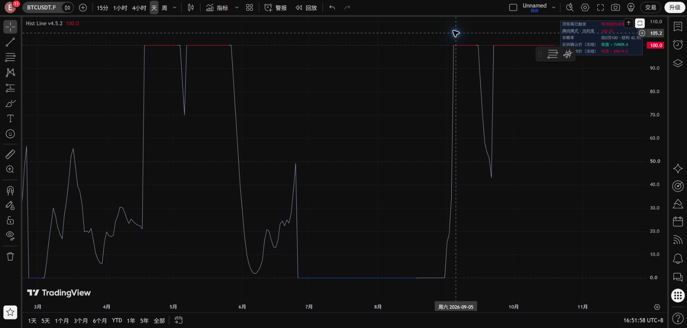
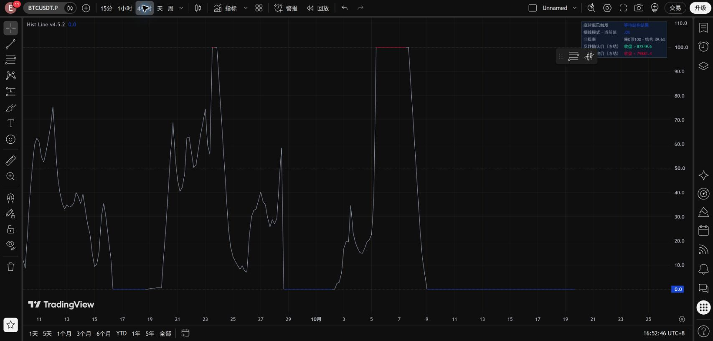

# Hist Line v4.5.2：面板显示两个冻结价位

只在右侧面板新增两行，保留v4.5.1曲线、颜色和全部信号规则。

| 当前正式背离 | 反转确认价（冻结） | 背离失效价（冻结） |
|---|---|---|
| 底背离 | 收盘 > 确认价 | 收盘 < 失效价 |
| 顶背离 | 收盘 < 确认价 | 收盘 > 失效价 |

两个价位直接读取原事件的`confirmationPrice`、`invalidationPrice`，不会随新K线移动。使用商品最小价格单位格式显示。确认价为绿色、失效价为红色；这是面板文字颜色，不改变曲线端点着色。

底背离的确认价是生效时冻结区间最高价，失效价是区间最低价减去冻结ATR缓冲；顶背离相反。缓冲仍为原参数，默认0.5 ATR。盘中触及失效位继续使用原有预警，只有收盘严格越界才正式结束，恰好等于边界不算收盘越界。

没有正在生效的正式背离时显示“—”，不展示上一轮残留价位。同一根收盘旧事件结束且新事件触发时，显示新事件的冻结价位。

## 验证

源码排除版本名及新增面板行后，与v4.5.1全文一致。TradingView网页端BTCUSDT永续4H/1D编译显示成功，编辑器源码回读一致。新版保留旧版，未重新运行收益回测，因为计算与交易事件没有改变。

