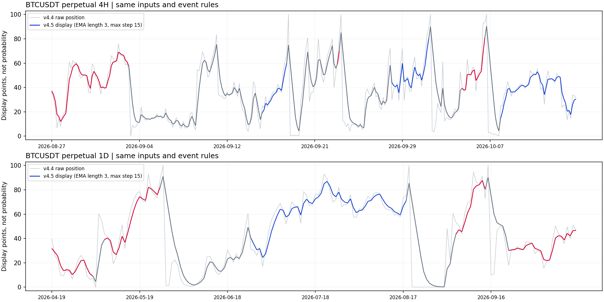
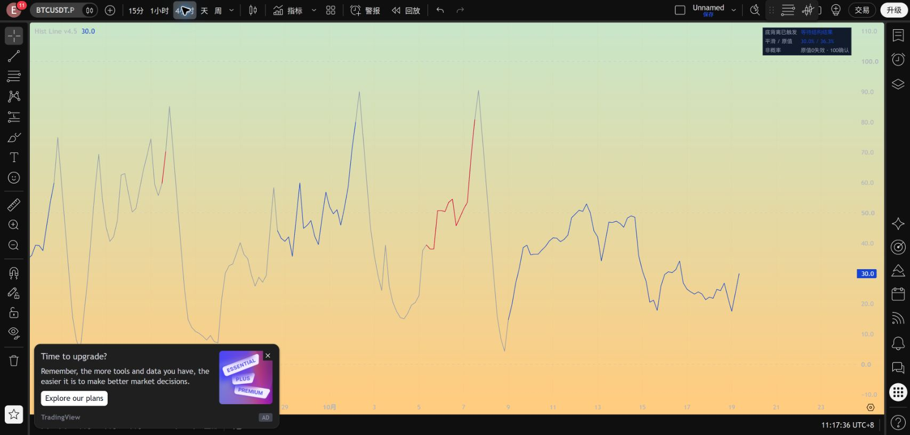
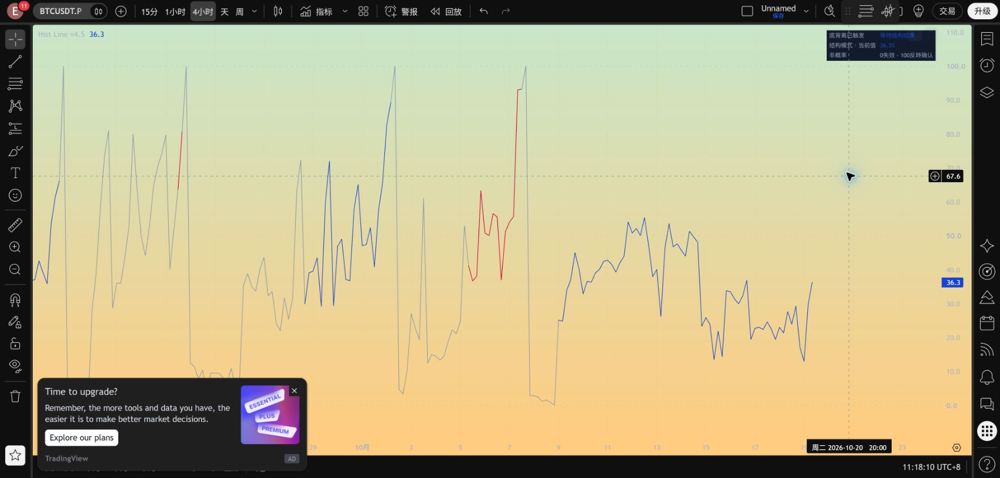
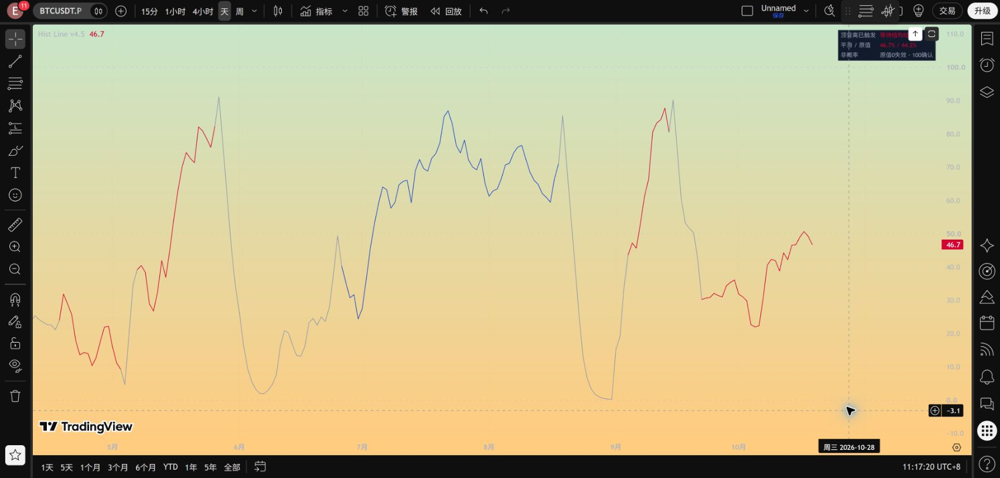

# Hist Line v4.5：仅显示曲线平滑

v4.4 原文件完整保留。本版只对最终显示值增加因果平滑，MACD、历史价格枢轴、候选形成评分、正式背离触发、结构确认与失效、事件期限及警报代码均保持不变。

## 使用

默认主线模式为“结构位置”，启用“曲线平滑”：

| 设置 | 默认值 | 效果 |
|---|---:|---|
| 平滑周期 | 3 | 越大越平缓，也越滞后；1取消指数部分但仍保留变化上限 |
| 单根最大变化（点） | 15 | 越小越平缓；限制相对于上一根收盘显示值的移动幅度 |
| 启用曲线平滑 | 开 | 关闭后完整恢复 v4.4 原始显示数值 |

想再柔和一点，可仅把平滑周期从3调到5；希望反应更快可调回3或关闭。这里只调整视觉响应，不代表交易参数优化。日线3根与4H的3根代表不同时间长度，不能把平滑周期理解为固定小时数。“持续横线”模式完全绕过平滑，保留旧版横线与配色。

## 明确算法

设 `x[t]` 为 v4.4 的原始主线值，`y[t-1]` 为上一根K线收盘后的显示值：

```
alpha = 2 / (平滑周期 + 1)
变化 = clamp(alpha * (x[t] - y[t-1]), -单根最大变化, +单根最大变化)
y[t] = clamp(y[t-1] + 变化, 0, 100)
```

首根有效数据以原值初始化。盘中每次报价都从上一根收盘值重新计算，不按报价次数累加；不使用未来K线、不回填历史。跨枢轴、方向及阶段时也保持连续过渡，但过渡值不是同一个参照下的真实进度。

这不是把Hist本身平滑后重新判断背离，也不是重新标定0/100。它是原始显示值的滞后视图：例如原值突然从0升至100，默认显示为0、15、30、45、60、75、87.5……，而不是一次跳到100。

## 颜色、风险和结果不等待平滑

- 正式顶背离生效期间红色，正式底背离生效期间蓝色。
- 未触发、结束后和跨事件连接段灰色，着色规则与v4.4逐字一致。进入事件的连接段保持灰色，避免把上一根未触发的点误染色。
- 触及失效位时，面板原有风险预警立即更新；正式失效仍按原收盘规则执行。主线方向色不被风险色覆盖。
- 事件确认或失效当根，面板立即显示结果、主线立即结束方向着色。**平滑曲线可能还没有到100或0，不能据此推断事件还没结束。**
- 未平滑结构原值的0是失效边界、100是反转确认边界；平滑值不再是当前价格的精确位置。面板同时显示“平滑 / 原值”，数据窗口保留所有原始审计字段并新增未平滑主线值。
- 事件结束后的灰色过渡不会延长事件，也不会延迟下一次正式信号的允许时间。

百分比均不是成功概率。平滑必然牺牲数值及时性，不宣称既完全无滞后又明显平缓；状态判定仍使用原数据。

## 检查

复现：`python src/verify_hist_line_v45.py`。

保存的4H 12,684根、1D 2,114根，共14,798根回放中：

| 检查 | 4H | 1D |
|---|---:|---:|
| 原曲线平均单根绝对变化 | 7.74点 | 9.60点 |
| 平滑后平均单根绝对变化 | 4.28点 | 5.44点 |
| 平滑后最大单根变化 | 15点 | 15点 |
| 平滑值与原值平均绝对差 | 5.37点 | 7.41点 |

底层和候选代码、原有审计输出及警报、配色及风险表达式均与v4.4逐字相同。关闭平滑与v4.4数值一致；横线模式与v4.4一致；无空值、无越界、无超调，截取历史前缀不会改变已计算结果。逐根原值、平滑值及状态保存在 `results/hist_line_v4_5/`。

这是显示验证，不是新的准确率或收益回测，也不是完整TradingView历史导出对账。[检查记录](../results/hist_line_v4_5/checks.json)。原回测规则及结果不因平滑显示而提高。

## 可视对照与实际运行

同一历史数据和事件区间的对照，浅灰为v4.4原值，深色为v4.5显示值：



2026-10-19已在TradingView BINANCE:BTCUSDT.P 4H、1D另存并编译运行，编辑器源码回读一致；4H实测平滑开关，面板在开启时显示“平滑 / 原值”，关闭后回到原值。最终留在4H默认平滑设置。[实测记录](../results/hist_line_v4_5/tradingview_checks.json)。未进行完整历史导出对账。






