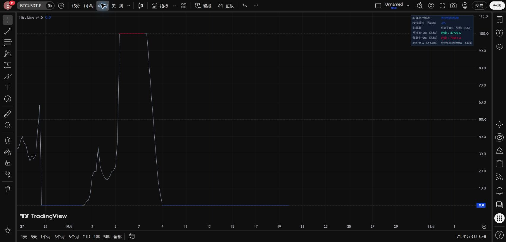
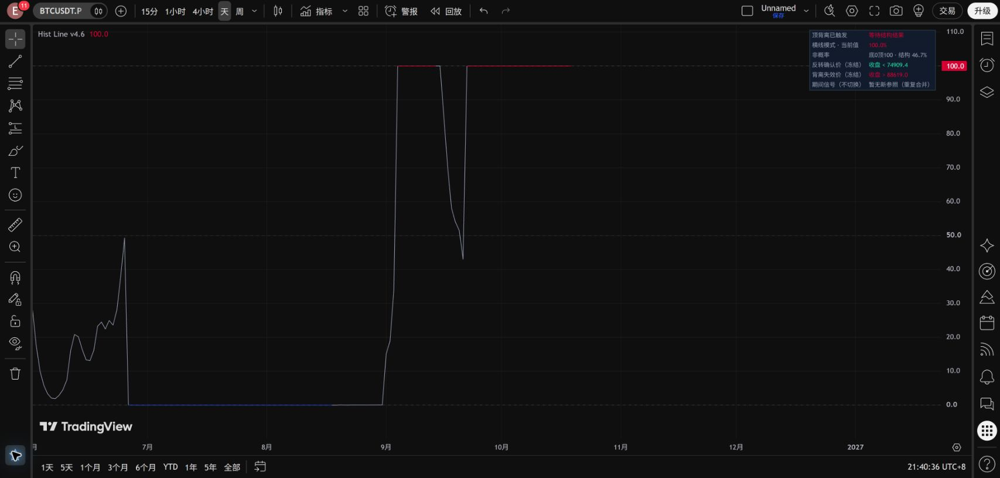

# Hist Line v4.6：一条主线，合并期间信号

## 固定基线

[v4.5.2固定发布](https://github.com/Lammmmm/btc-divergence-research/releases/tag/hist-line-v4-5-2)已经先行上传，标签、提交、完整数据包和SHA256记录见[基线记录](../config/hist_v452_frozen_baseline.json)。后续不覆盖该标签、旧源码或附件。“锁定”指固定版本归档，并非设置GitHub仓库写保护。

## 本版行为

主线仍只跟踪一个正式事件。顶背离100红横线，底背离0蓝横线，其余连接灰色。当前事件的确认价、失效价不移动、不重新计时，也不因出现反向信号而判为失效。

右侧仅增加一行“期间信号（不切换）”：

- 当前事件的同向重复：合并，不增加标签或警报。
- 同向新参照：“曾现同向新参照 · N根前”。
- 反向信号：“曾现反向顶/底背离 · N根前”，黄色文字，显示优先于同向提示。
- 无新参照：“暂无新参照（重复合并）”；事件结束后清空，不补发积压信号。

“曾现”是当前事件期间出现过的历史信息，不代表这个反向信号现在仍有效，不是新事件启动，更不是原事件已经失败。同向新信号不能覆盖已记录的反向提醒；更新为最新一组反向信号的出现时间。旧事件结束后仅使用当根原始算法条件决定是否启动新事件，后续重新评估候选。

## 去重定义

分组键为“当前主事件 + 信号方向 + 历史参考价格枢轴”。同一个参考枢轴对应的后续端点，包括中间断续后再次成立，均合并为一组。改变参考枢轴才增加一组。此为展示分组，不声称两组信号统计独立，也不改变原算法的触发条件。这样有意优先抑制重复提示，不试图把同一枢轴的每个后续端点都展示出来。

原事件启动时把自身参照加入已见集合。记录只在收盘提交；盘中变化不会反复改写提示。若同根同时存在顶底条件，不分类为一个新增方向。已不可能被最大跨度再次引用的旧参照从去重集合移除，历史提示记录仍保留至事件结束。

## 不变内容及限制

MACD、原始背离搜索、候选评分、原有事件生命周期、确认/失效、主线平滑与颜色、原有四项警报全部与v4.5.2一致。新增提示无新警报、无新标签、无第二条曲线。面板显示最后一根状态；逐根合并记录和计数可在数据窗口或保存的检查账本复盘。

本版解决的是横线期间新信息不可见、逐条提示会杂乱的问题；不会缩短长期横线，也不会增加实际交易事件或改变原收益回测。若以后收紧确认/失效范围，需要另外研究。

## 验证

对源码去掉新增提示模块、面板行、审计输出和版本名后，全文与v4.5.2一致。合成检查覆盖重复、间隔后重复、反向优先、盘中不提交、冲突、结束清空和同根新事件重置。

对原保存历史记录重放：

| 周期 | K线数 | 等待期间原始信号根数 | 新参照组 | 合并重复根数 | 同向新组 | 反向新组 |
|---|---:|---:|---:|---:|---:|---:|
| 4H | 12,684 | 139 | 83 | 56 | 41 | 42 |
| 1D | 2,114 | 16 | 8 | 8 | 4 | 4 |

分组用独立的完整历史键集合复核通过。这是显示逻辑重放，不是新增收益回测，也不是完整TradingView历史导出对账。检查脚本：`python src/verify_hist_line_v46.py`；[记录](../results/hist_line_v4_6/checks.json)。

## 网页实际运行

2026-10-19，BINANCE:BTCUSDT.P的1D和4H加载成功，编辑器源码回读一致。4H面板显示“曾现同向新参照 · 4根前”，主线继续保持底背离0横线；日线当前事件没有新增参照。反向提示、冲突与结束清空等分支由离线检查覆盖，未声称已逐一在实时网页触发。

