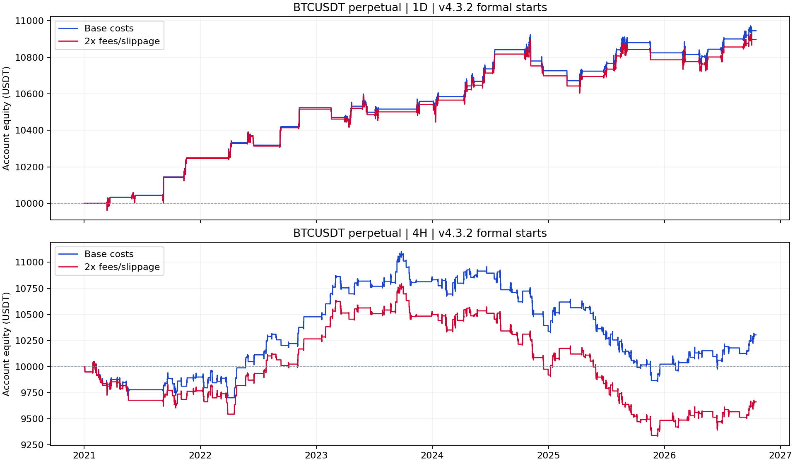

# Hist Line v4.3.2：当前事件回测

报告日期：2026-10-19；数据截止2026-10-15 UTC。

## 本轮回答的问题

测试当前 Hist Line v4.3.2 的正式背离事件，而不是所有原始 Hist 提示，也不是灰色形成曲线。使用 BINANCE BTCUSDT USDT 永续的同一份历史快照，2020 年预热，正式区间为 2021-01-01 至 2026-10-15 UTC。不增加指标组合、不搜索参数；本次未下载更新至 10 月 19 日的数据。历史已经看过，近期段不能当成未见样本。

## 先读结论

日线结构成功 27/38，即 71.05%；4H 为 83/201，即 41.29%。配合原有交易规则，日线累计净收益 9.46%，4H 为 3.05%。手续费与滑点翻倍后分别为 8.98%、-3.37%。日线样本只有 38 笔成交；4H 对成本敏感。显示优化没有改变正式信号，不能把这些结果归因于颜色或曲线的改进。

## 一、结构反转成功率：与当前横线一致

成功=后续收盘突破冻结确认位；失败=后续收盘突破冻结失效位；影线触线只警告。允许长期横盘，没有根数超时。成功率=成功/(成功+失败)，待定单列。每次只跟踪一个多空共用事件，结束前的新提示忽略；结束当根可重新触发。

| 周期 | 原始提示根数 | 正式事件 | 成功 | 失败 | 待定 | 已完成成功率 | Wilson描述区间 |
|---|---|---|---|---|---|---|---|
| 1D | 55 | 39 | 27 | 11 | 1 | 71.05% | 55.24%–83.00% |
| 4H | 341 | 202 | 83 | 118 | 1 | 41.29% | 34.71%–48.20% |

## 顶底分开统计

方向子样本较小，区间仅作描述。不是未来成功概率，也没有校正历史筛选和市场相关性。

| 周期 | 方向 | 成功/已完成 | 失败 | 待定 | 成功率 | 描述区间 |
|---|---|---|---|---|---|---|
| 4H | 底背离 | 41/85 | 44 | 1 | 48.24% | 37.92%–58.70% |
| 4H | 顶背离 | 42/116 | 74 | 0 | 36.21% | 28.03%–45.27% |
| 1D | 底背离 | 12/15 | 3 | 0 | 80.00% | 54.81%–92.95% |
| 1D | 顶背离 | 15/23 | 8 | 1 | 65.22% | 44.89%–81.19% |

## 等待和期间逆向波动

下表的等待、逆向波动只统计最终成功的事件；不代表最大风险或账户回撤。失败和待定事件的路径也完整保存。确认/失效距离为全部事件中位数，两个边界距离不对称，50%并非天然随机基准。

| 周期 | 成功等待中位天数 | 等待P90天 | 成功前逆向中位 | 逆向P90 | 确认距离ATR | 失效距离ATR | 待定全失败/全成功边界 |
|---|---|---|---|---|---|---|---|
| 1D | 15.0 | 56.8 | 3.21% | 9.42% | 2.438 | 1.411 | 69.23%–71.79% |
| 4H | 2.5 | 13.2 | 1.03% | 4.58% | 3.153 | 1.460 | 41.09%–41.58% |

## 二、沿用旧交易规则的收益

这是附加交易规则的收益，不是指标自带收益。每组独立 10,000 USDT；正式事件收盘触发后下一根开盘入场，ATR(14)×1.5 止损、2R 止盈、最多持有10根；单笔计划风险0.5%，名义仓位最多约1倍净值。手续费单边0.05%、滑点单边0.02%，计入历史资金费；小时内止盈止损同时触及时先算止损。交易提前退出不会结束指标事件，也不会让原本被忽略的信号重新入场。日线有1次事件启动时旧交易仍在，故39个事件、38笔交易。净收益为整段累计收益，非年化；最大回撤按小时收盘浮动净值及出场点统计，不是盘中极值。

| 周期 | 成交笔数 | 净盈利胜率 | 累计净收益 | 期末USDT | 最大回撤 | 盈亏因子 | 平均净R | 成本翻倍净收益 |
|---|---|---|---|---|---|---|---|---|
| 1D | 38 | 65.79% | 9.46% | 10,945.57 | 2.67% | 2.956 | 0.479 | 8.98% |
| 4H | 202 | 46.04% | 3.05% | 10,304.90 | 11.21% | 1.063 | 0.033 | -3.37% |

## 收益的不确定性

平均净R区间使用旧报告同口径：连续5笔循环块、2,000次重采样，仅作历史描述。净盈利胜率与结构反转成功率分母不同。底/顶收益拆分共用同一条账户资金路径，各方向净损益不能当作独立账户收益率。

| 周期 | 平均净R描述区间 | 底背离成交/胜率 | 底背离净损益USDT | 顶背离成交/胜率 | 顶背离净损益USDT |
|---|---|---|---|---|---|
| 1D | 0.170–0.784 | 15 / 60.00% | 213.37 | 23 / 69.57% | 732.20 |
| 4H | -0.117–0.194 | 86 / 48.84% | 541.04 | 116 / 43.97% | -236.14 |

## 三、前段和近期诊断

前段为2021–2024；近期为2025-01-01至2026-10-15。每段独立重置事件和10,000 USDT账户，保留此前指标预热。因此分段不能相加或连乘成全样本；近期不是未见样本，未进行择优参数选择。

| 周期 | 时期 | 结构成功/完成 | 结构成功率 | 交易笔数 | 净盈利胜率 | 净收益 | 成本翻倍净收益 |
|---|---|---|---|---|---|---|---|
| 4H | 前段 | 59/137 | 43.07% | 137 | 45.99% | 3.94% | -0.25% |
| 4H | 近期 | 23/63 | 36.51% | 64 | 46.88% | -0.33% | -2.59% |
| 1D | 前段 | 17/25 | 68.00% | 25 | 68.00% | 7.26% | 6.99% |
| 1D | 近期 | 10/14 | 71.43% | 15 | 53.33% | 1.00% | 0.80% |

## 四、与原始 Hist 提示比较

两者使用完全相同的旧交易引擎、费用和历史区间。当前版本只在上一结构结束后才接受新提示，交易样本发生变化；不是把原始信号的正确率用显示方式提高了。原始Hist交易基准已重算并与旧报告一致。

| 周期 | 信号口径 | 成交 | 净盈利胜率 | 净收益 | 最大回撤 | 成本翻倍收益 |
|---|---|---|---|---|---|---|
| 4H | 当前事件启动 | 202 | 46.04% | 3.05% | 11.21% | -3.37% |
| 4H | 原始Hist提示 | 302 | 45.03% | -1.43% | 14.59% | -10.84% |
| 1D | 当前事件启动 | 38 | 65.79% | 9.46% | 2.67% | 8.98% |
| 1D | 原始Hist提示 | 47 | 63.83% | 10.38% | 3.67% | 9.80% |

## 数据质量与核查范围

当前Pine没有硬编码剔除历史异常K线，因此主结果按保存的原生周期数据复现；另存旧报告的数据隔离口径作敏感性核查。全样本日线有0个事件细节差异，4H有1个；两周期的成功/失败总数均未变化。4H原生与小时聚合存在两根已记录的OHLC不一致，具体事件差异见quality_comparison.json；不能声称所有事件边界完全相同。交易收益仍执行旧规则的异常价格区间剔除，本轮当前事件交易被该项剔除为0。代码、指标预热、信号跨度、逐根状态、收盘首次突破、资金费、成交和小时净值已复核。这次是Python逻辑复现，尚未完成TradingView全历史导出逐根对账；现有TradingView编译/实图检查不能代替该项验证。

## 文件与复现

方案：config/hist_v432_backtest.json。数据与逐项输入SHA256：results/hist_v432_backtest/input_hashes.json。逐事件events/、每根状态timeline/、忽略原因ledgers/、逐笔交易trades/、小时净值equity/、交易筛选trade_ledgers/均保存为JSONL.GZ。所有汇总及独立核查结果在results/hist_v432_backtest/；旧数据、旧报告与Pine脚本未覆盖。复现命令：python run_hist_v432_backtest.py。未来数据验证仍待进行。
